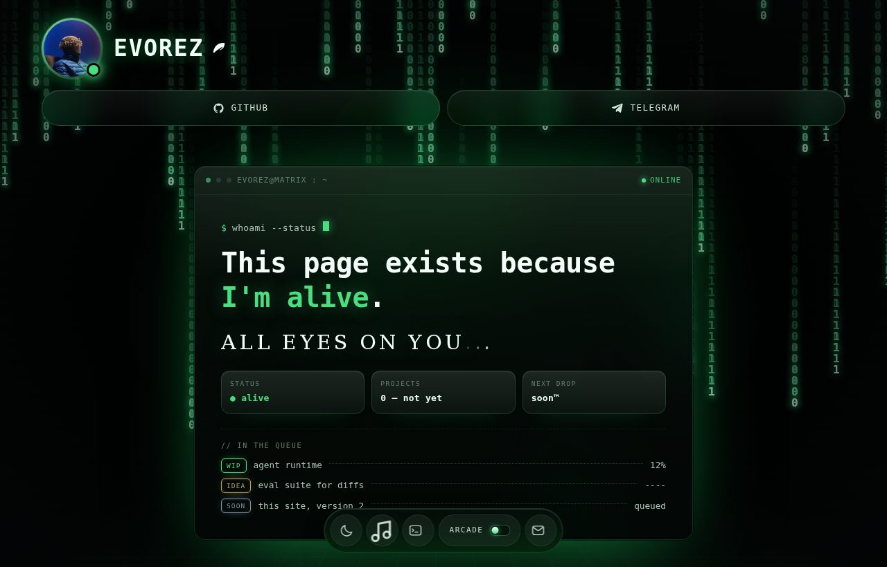
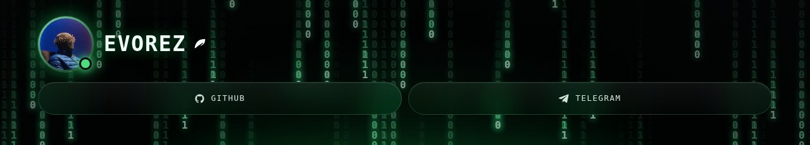
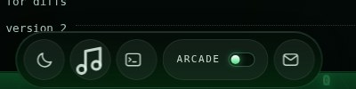
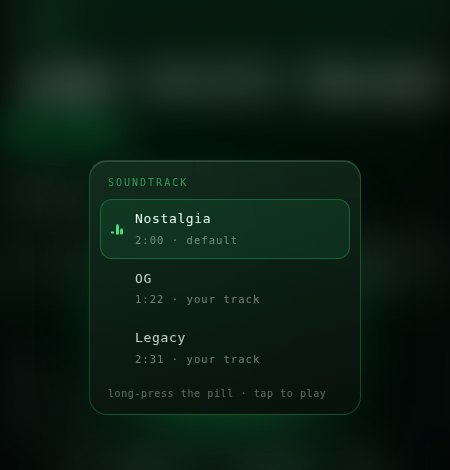
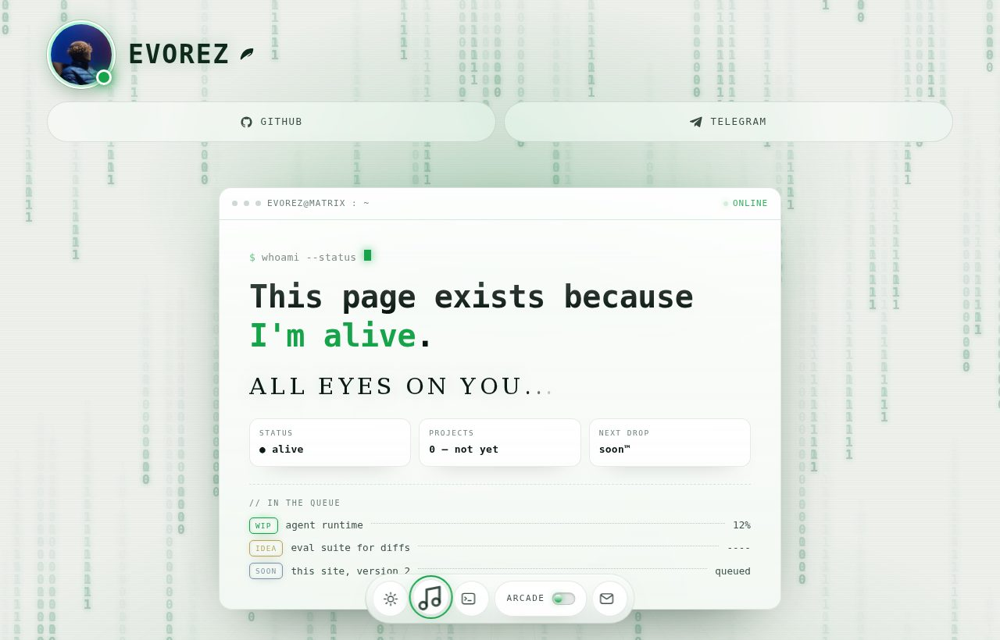
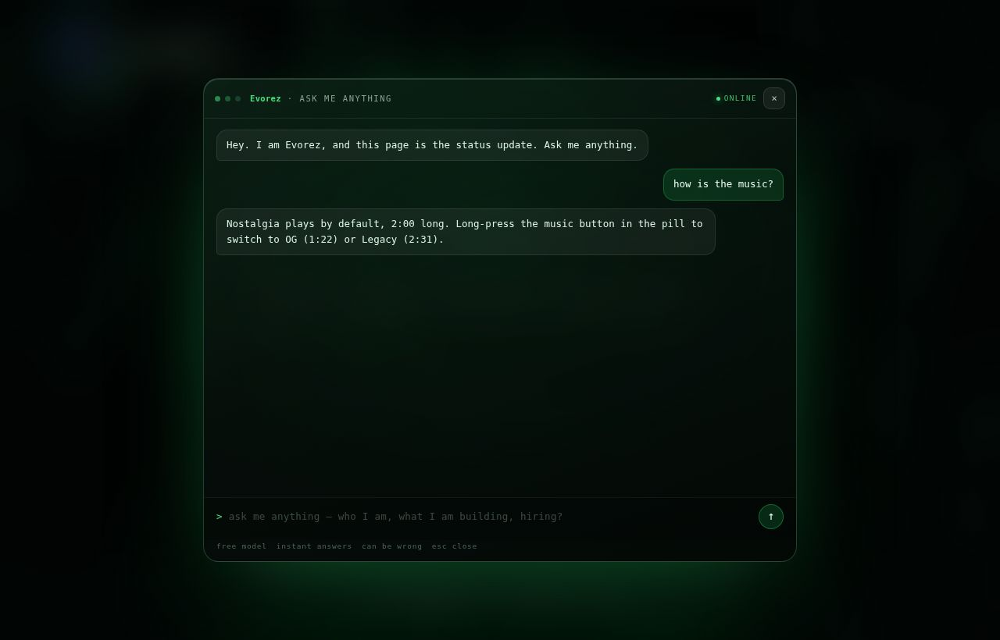
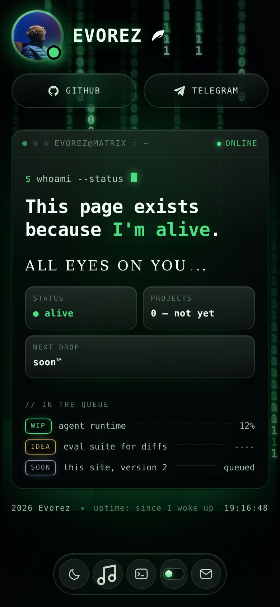

# Evorez — landing page

**Live:** https://evorez.vercel.app



| | |
| --- | --- |
|  |  |
| avatar, `EVOREZ` wordmark, frosted GitHub / Telegram | appearance · music · chat · arcade · gmail |
|  |  |
| long-press the pill → Nostalgia (default), OG, Legacy | light mode: sun icon, light matrix |
|  |  |
| the chat answers from a curated FAQ, free model fallback | 390 px: same header, same pill |

Screenshots are regenerated from the live site with Playwright (`docs/`).

> **Current build (2026-11-19):** the arcade is empty on purpose. All four games and the city were
> removed; the ARCADE toggle now shows a loading screen that ends in "no games yet". Everything below
> that describes games or the city is history, kept for reference.  ·  Vercel project `evorez` (team `evorez.alive`)

A single-file, production-ready landing page. No build step, no dependencies, no network calls:
`index.html` contains the markup, all CSS, one inline script, two base64-embedded variable fonts
(Inter + JetBrains Mono), the brand logo, and the author portrait — so it renders identically
offline and inside sandboxed previews.

## Layers

- **Header** — avatar, `Evorez` wordmark and two frosted **GitHub / Telegram** buttons (`backdrop-filter` over the rain).
- **Pill** — appearance (moon in dark, sun in light), music, chat, arcade, gmail. GitHub and Telegram live in the header only.
- **Rain** — 0/1 only, drawn on a canvas at the bottom of the stack (`z-index:-1`) at the panel's own refresh rate; it fades to the page colour of the current theme, so light mode stays light.

## Soundtrack

Three tracks live inside the file as base64 data URIs, decoded with the Web Audio API:

| track | length | note |
|---|---|---|
| **Nostalgia** | 2:00 | **default** — the first tap anywhere starts it (browsers block audio before a gesture) |
| OG | 1:22 | tap the pill at any time to start / stop |
| Legacy | 2:31 | long-press the pill to switch |

Files: `src/nostalgia.mp3`, `src/og.mp3`, `src/legacy.mp3`.


## Copyright and copy protection

The site is proprietary: see `LICENSE`. It is public to read, not to reuse.

What ships with every build:

- a copyright comment and build fingerprint at the top of `index.html`
- `<link rel="canonical">`, author / copyright meta and Open Graph tags, so a
  copied page still points search engines at `evorez.vercel.app`
- a **copy guard**: on any host that is not `evorez.vercel.app` (or localhost /
  a preview sandbox), the page shows an `unofficial copy` badge and logs a
  console warning. It does not break the page - it just marks it, which is the
  evidence a DMCA notice needs
- `vercel.json` headers: `X-Frame-Options: SAMEORIGIN` (nobody can embed the
  site in theirs), `nosniff`, a referrer policy and a permissions policy

If someone lifts it anyway:

1. screenshot their URL with the badge visible, plus `view-source` showing the
   copyright comment and fingerprint
2. file a DMCA / copyright report with their host (Vercel, Netlify, GitHub
   Pages, Cloudflare) and with GitHub if the source is public
3. email `evorez.alive@gmail.com` a copy of the notice so the record exists

Nothing client-side can stop a determined rebuild - but a rebuild is a *new*
site, not a copy, and that is not something a licence or a script can prevent.

## The chat (replaces the old terminal)

The dock's third button opens **Evorez's chat** — a real LLM with no key in the page.

- endpoint: `https://text.pollinations.ai/openai` (free tier, no key, CORS `*`), OpenAI-compatible
- **your persona / custom instructions** live in `src/chat.js` → the `BOT` block (`persona`, `starters`,
  `greeting`, `model`). That is the only place to edit; the build inlines the file.
- free tier allows **one reply per 45 s per IP**; when it answers with `402` the bot shows the wait
  in the header, counts down, and falls back to a local Hinglish reply bank (`LOCAL[]`) so it never
  goes silent
- emoji are stripped from replies (the page embeds exactly one emoji glyph — 👀 — so anything else
  would render as tofu)
- `py-lite` and the whole terminal script were removed with it (−32 KB)


## Brand assets

| Asset | Source | In the page |
| --- | --- | --- |
| Logo (red/silver EZ monogram) | `assets/logo-160.png` | base64 in nav + footer `.brand__mark`, and as the favicon (`assets/favicon-64.png`) |
| Author portrait | `assets/author-620.jpg` | base64 in the `#author` section |
| Fonts | Inter + JetBrains Mono (latin subsets) | base64 `@font-face` at the top of the `<style>` block |

The raw files also live in `assets/` if you need them for social cards, decks or a favicon set.
To swap an image, re-encode it and replace the `src` in the two `.brand__mark` tags (or the
author ``).

## Positioning used

> **Evorez — engineering intelligence that ships.**
> A coordinated team of AI agents (Planner, Builder, Reviewer, Guardian) that plan, build,
> test and review production software inside your existing repo, CI and review process —
> with human control by default.

Goal: awareness first (the brand is new), conversion second — every path leads to
"Request private beta access" / the email capture in the final CTA.

## Structure

1. Sticky navbar — blur-on-scroll, scroll progress bar, active-section highlighting, Telegram +
   GitHub icon links, mobile drawer
2. Hero — headline, sub-copy, dual CTA, trust micro-proof, live "agent console" product visual
3. Social proof — customer wordmark marquee
4. Result metrics — animated counters
5. Platform — 6-card bento grid with cursor-tracking spotlight
6. Product showcase — 4 interactive tabs (Plan / Build / Verify / Observe), keyboard-navigable
7. Benefits — value list + "90-day impact" panel with animated bars
8. Testimonials — 3 quotes + a feature quote
9. **The author** — portrait, first-person note, Telegram + GitHub links (`#author`)
10. Pricing — 3 plans, monthly/annual toggle with animated price swap
11. FAQ — accessible single-open accordion
12. Final CTA — email capture with inline validation and success state
13. Footer — 4 link columns, socials (Telegram / GitHub / X → @evorez), status pill, wordmark

## The arcade (currently empty)

Every game has been removed — MATRIX RUN, SNAKE.EXE, EZS and the Neon Nagar city are all gone
(markup, script, CSS and picker cards). The `ARCADE` toggle in the navbar still opens `arcade.exe`,
but it now shows a loading bar that runs to 100 % and then a short "no games yet — the arcade is
being rebuilt" panel with a BACK button. Nothing to play until the rebuild lands.

- layer: `#gameLayer` → `.game__box` (glass) → `.arc` (`data-phase="load" | "soon"`)
- loader: `<div class="arc__bar" role="progressbar">` filled with `transform:scaleX(n)` (never `width`,
  because a width transition inside the glass box resolves to 0 px)
- keys: `Esc` closes, `Tab` cycles ✕ / BACK, focus returns to the toggle on close
- reduced motion: the bar jumps straight to 100 % instead of animating
- hooks: `window.__arcade.open() / close() / phase()`
- the rain is binary now: the glyph set is `'01'` (no katakana anywhere in the file)
- the hero line is **ALL EYES ON YOU ... 👀** with a three-dot loading animation (static under reduced motion) — a 3.4 KB subset of DejaVu Serif (`'Evorez Roman'`) gives the
  small-caps inscription look on every device, and a 0.9 KB slice of Noto Color Emoji makes the eyes
  render even where no emoji font is installed.
- **Soundtrack** — two real tracks from the owner's Drive, embedded as base64 data URIs so the page
  stays one file: `Legacy` (2:31, **default, on**) and `Urban` (0:38). Tap the pill = play/pause,
  **long-press 460 ms** = the soundtrack card (also `contextmenu`, `ArrowUp/Down`, `Escape`).
  Choice persists in `evorez_track`, play state in `evorez_music` (`'0'` = muted).
  Both cards (soundtrack + appearance) morph out of the pill and dim the page behind a blurred scrim.
- **Theme change animation** — switching dark/light runs a View Transition: the new theme is
  revealed by a `clip-path` circle growing out of the appearance pill (~620 ms). Falls back to the
  normal CSS colour transition where `startViewTransition` is missing, and to an instant swap under
  `prefers-reduced-motion`. `html.theme-swap *{transition:none}` keeps the swap from double-animating.
- **Layering** — `.shell` is a stacking context (`z-index:2`), so the appearance card must live in
  `<body>`, not inside `.dock`; otherwise the blurred scrim (`z-index:69`) paints over it and the
  card is both blurred and unclickable. Both island popovers now sit in `<body>` at `z-index:90`.
- popovers opened from the dock (appearance/theme, and anything else) are **centred above the pill**,
  not above the individual button, and **morph out of it** — the card starts as a small pill-shaped
  blur at the pill's edge (scale .32/.18, border-radius 999px) and springs to full size over ~0.42 s,
  iOS Dynamic-Island style. Closing reverses it; `hidden` is applied only after the transition ends.
- every nav control now lives in a **floating iOS-style dock** (`#dock`, bottom centre, blurred glass
  pill). The header keeps only the wordmark.
- the dock has a **music toggle** (`#musicBtn`, note icon + eq bars): one click = play, one click = stop.
  There is **one track only** — an original brooding title-theme: slow 4/4 in D minor, string ostinato
  over a low drone, sparse lead, soft kicks and a metallic tick. No track picker, no long press. Everything is synthesised in WebAudio — no audio
  file, no network, no third-party music. Source: `src/music.js`; state in `localStorage['evorez_music']`.
- the old full build is kept at `archive/index-full-games-final.html` if a game ever needs restoring


## Design system

All tokens live in `:root` at the top of the `<style>` block:

| Token | Value | Use |
| --- | --- | --- |
| `--bg` | `#06070c` | page base |
| `--brand` | `#ff5252` | electric red — primary accent |
| `--brand-2` | `#c8102e` | deep crimson |
| `--brand-3` | `#3fe0d0` | mint — **semantic only** (live, verified, success) |
| `--grad` | warm metal → red → crimson | gradient text, bars, badges |
| `--font-sans` | Inter (embedded) | UI + display |
| `--font-mono` | JetBrains Mono (embedded) | code/console surfaces |

The palette is derived from the logo (black / brushed silver / electric red). Primary buttons use
a brushed-metal fill with a red glow, which keeps one metallic + one hot accent instead of two
competing hues. To go back to a different accent, change only `--brand`, `--brand-2` and `--grad`.

Type scale is fluid (`clamp()`), spacing is fluid, and the layout is mobile-first
(breakpoints at 1024 / 900 / 720 / 400 px).

## Motion

- Scroll reveals via `IntersectionObserver`, staggered with `--d` CSS variables
- Counters count up once on entry
- Ambient drifting orbs, marquee logos, floating stat chips
- Micro-interactions: magnetic buttons, sheen sweep on the primary CTA, cursor spotlight on bento
  cards, subtle 3D parallax on the hero console, accordion height animation, animated price swap
- Everything degrades: `prefers-reduced-motion` disables all of it, and a `<noscript>` block
  makes hidden content visible without JS

## Accessibility

- Verified with axe-core: **0 violations** for WCAG 2.0/2.1 A + AA + best-practice at
  1440 / 1280 / 1024 / 768 / 390 / 320 px
- Skip link, semantic landmarks, one `h1`, ordered headings
- Tabs implement the WAI-ARIA tabs pattern (arrow / Home / End keys, roving tabindex)
- Accordion buttons use `aria-expanded` / `aria-controls`; the form has a label, `aria-invalid`
  and a polite live region
- Visible `:focus-visible` rings, decorative images/SVGs hidden from AT, no horizontal overflow
  from 320 px upward
- External links open in a new tab with `rel="noopener noreferrer"` and say so in their labels

## Deploy

```bash
cd evorez && VERCEL_TOKEN=xxxxx ./deploy.sh     # links dist/ to the `evorez` project and pushes to production
```

Or drag `evorez-site.zip` onto any static host (Netlify Drop, Cloudflare Pages). See `DEPLOY.md`.

## Editing

- **Copy / pricing:** edit the HTML directly; prices live in `data-monthly` / `data-annual`
  attributes on `.amt` spans — the toggle reads them.
- **Counters:** `data-count`, `data-suffix`, `data-prefix`, `data-decimals` on the number element.
- **Author section:** replace the name/role in `.author__body` (there is no invented full name —
  it reads `@evorez` so you can drop the real one in).
- **Socials:** all `t.me/evorez`, `github.com/evorez`, `x.com/evorez` links are `@evorez`;
  search and replace the handle to change everywhere at once.
- **Form:** `#ctaForm` validates and shows a success state client-side — point it at your
  endpoint (or a hosted form) to go live.

### Redesign v3 — hybrid (current `index.html`)

Dark hero + dark CTA/footer bookend, light `#faf9f7` "sheet" in between (rounded 26px edges).
7 sections: nav → hero (with PR diff panel) → social proof → four agents → how it works → pricing → CTA + footer.
Measured: 280 DOM nodes, 0 infinite animations, 4,270px tall at 1440px (v1: 1,142 nodes, 45 infinite animations, 10,722px).
Alternatives kept in `versions/v3-a-calm-dark.html` (all dark) and `versions/v3-b-light-minimal.html` (all light).

### v4 — dark/light theme toggle (current `index.html`, not yet deployed)

Single page, one content set, two themes: `:root` = dark (default), `:root[data-theme="light"]` overrides the token set.
Toggle lives in the nav (sun/moon segmented control) + mobile drawer "Appearance" row; choice is stored in `localStorage`
(`evorez-theme`) and first visit follows `prefers-color-scheme`. Applied before paint via a tiny inline head script (no flash).
Measured: 280 nodes, 0 infinite animations, 4,270px / 6,047px tall, all sampled text ≥ 4.73:1 contrast in light, ≥ 6.33:1 in dark.

### v5 — "Webflow template" style redesign (current `index.html`, not deployed)

Reference direction: fc-tree.webflow.io — cream `#f7f4f0` canvas, lavender→blush gradient wash behind a transparent sticky nav,
oversized display type mixing grotesk + serif italic (Instrument Serif, embedded as woff2), big rounded cards,
floating status chips over a dark PR-diff window, alternating feature cards, testimonial + pricing + contact form + huge footer wordmark.
Self-contained: Inter + Instrument Serif embedded, logo + author portrait as data URIs, no network requests.
Measured: 8 sections, 487 nodes, 0 infinite animations, 7,387px desktop / 9,402px mobile, 407 KB single file.

### v6 — Matrix "I'm alive" page (current `index.html`, not deployed)

Single screen, no fake projects. Fields of digital rain on canvas (katakana + digits, ~15fps, pauses when the tab is hidden,
off under `prefers-reduced-motion`), vignette + scanline overlay, and one terminal card in the middle:
`$ whoami --status` (typed), "This page exists because I'm alive.", status / projects 0 / next drop, an "// in the queue" list,
and a Telegram CTA. Top-left: circular author photo with live dot + `Evorez` wordmark (mono italic + wing SVG, matching the
𝙴𝚟𝚘𝚛𝚎𝚣 look without relying on math-alphanumeric glyphs). Top-right: Telegram + GitHub `@Evorez`. Footer: year, uptime line, live clock, tg/gh.
Self-contained: JetBrains Mono + avatar + favicon all embedded. 1 screen (1440×900 and 390×844 both fit); current build ~208 KB including the arcade, the terminal and the theme system.

#### TESTING toggle + mini game (`#testToggle`, `#gameLayer`)

A `TESTING` switch in the top bar opens `matrix_run.exe`, a small canvas game in a modal:
catch falling green glyphs (+1), catch the rare white pill (+10), avoid red glyphs (−1 of 3 lives).
Steer with ← → / A D (keyboard) or drag/tap (pointer); SPACE or tap starts/retries; ESC or the ✕ closes.
Best score is kept in `localStorage['evorez_best']`. Game loop only runs while the modal is open.
Toggle text hides below 640px (switch only) so the top bar still fits 320px.

#### Game UI v2 — glass

Game box is now real glassmorphism: semi-transparent layered gradient + `backdrop-filter: blur(26px) saturate(170%)`,
1px light border, inner top highlight, outer green bloom. HUD are glass chips (score / best / 3 lives dots).
Start + game-over use a frosted glass panel with a `PLAY` / `RETRY` pill.
Touch: first touch snaps the bar instantly, then follows the finger with a ~1-frame ease (`dt*26`), pointer capture,
`touch-action:none` + `overscroll-behavior:none` while open, forgiving hitbox (14% of bar width), `navigator.vibrate` on hits.
Play area is taller on phones (`aspect-ratio:3/4`). Ambient drifting glyphs inside the stage add depth (off under reduced-motion).

#### Game picker + snake (`#gPick`, `.pickcard`, `#gBack`)

The toggle now opens `ARCADE.EXE`, a compact frosted picker with two glass cards — `MATRIX RUN` and `SNAKE.EXE`
(gradient icon tiles, hover lift + green bloom). Picking a card starts that game immediately; `◀ games` in the
title bar returns to the picker without closing the modal, and the card shrinks to fit the picker
(`.game__box.is-menu`) so there is no empty canvas underneath.

SNAKE.EXE is a classic grid snake: cell = `clamp(20–32px, W/15)`, 4-segment start heading right, food +1,
white "pill" food (15%) +5, speed ramps 0.17 s → 0.075 s per step, death on the wall or your own tail.
Controls: arrows / WASD, or swipe (18 px threshold) on touch. HUD swaps to `SCORE / BEST / LEN` — the lives dots
and the `LEN` chip hide through `[hidden]` (fixed with `.chip[hidden]{display:none}`, since `display:inline-flex` was winning),
and the hint row re-writes itself per mode. Bests live in `localStorage['evorez_best_snake']`.

#### Finger input (mobile) — hardened

Touch was rebuilt as a dedicated path because a single pointer-event handler silently failed on some real phones:
`pointerdown` / `pointermove` only drive **mouse + pen** now; on devices with `ontouchstart` the game listens to
native `touchstart` / `touchmove` / `touchend` (all `passive:false` + `preventDefault`, so the page never steals the gesture).
`touch-action:none` + `overscroll-behavior:contain` on `.game`, `.game__stage` and the canvas. Drag anywhere in the stage
for MATRIX RUN, swipe (14 px) for SNAKE, and tapping the stage after game over restarts.
A glass **d-pad** (`#gPad`, 4 arrows; only ◀ ▶ in run mode) appears on coarse-pointer devices
(`@media (hover:none),(pointer:coarse)`) with press-and-hold repeat — run: hold to slide, snake: tap to turn.
Desktop keeps arrows / WASD; the d-pad is `display:none` there. `window.__arcade.get()` exposes debug state for QA.

#### Appearance — dark / light × 3 accents

Every colour on the page is now a CSS variable, so one attribute flip re-themes the whole thing:
`<html data-theme="dark|light" data-accent="green|crimson|gold">`. The `◐` button in the top bar opens a glass
popover with a DARK/LIGHT segmented control and three accent swatches (Matrix green, crimson, gold).
Choice is saved in `localStorage['evorez_appearance']` and applied by a tiny pre-paint script in `<head>` (no flash).
Accents drive the rain, headline, glow, avatar ring, buttons, chips, glass tints **and the canvas games** — the arcade
reads its colours from a shared `window.__pal` palette (`PAL` + `ga()/aa()/ba()/pa()` helpers) that re-syncs on every change.
Light mode has its own deeper accent set (`#15803d` / `#be123c` / `#a16207`) so text keeps contrast, and the rain glyphs,
glass, chips, game stage, picker, d-pad and popover all get light-tuned surfaces.
Terminal command equivalents: `theme matrix|crimson|gold`, `mode dark|light`.

#### Terminal (`TERMINAL` button → `#termLayer`)

Its own toggle, next to TESTING. Glass shell window with scrollback, prompt, history (↑/↓), Tab completion, `esc` to close,
`ctrl+L` to clear, and a real `<input>` so the phone keyboard works.
Shell commands: `help`, `py`, `theme`, `mode`, `open game` (jumps to the arcade), `neofetch`, `date`, `time`, `uptime`,
`whoami`, `ls`, `echo`, `contact`, `version`, `clear`, `exit`.
`py` switches to a Python REPL. **Two backends, honestly labelled by the badge in the title bar:**
1. `python 3 · real` — Pyodide 0.26.4 is fetched from jsDelivr the first time `py` is used; then it is genuine CPython 3.12
   (`import sys` works). Needs network, so it is best on the deployed site.
2. `py-lite` — a built-in ~460-line interpreter (tokenizer → recursive-descent parser → evaluator) used offline or in the
   sandboxed preview. Supports ints/floats/bools/None/strings (incl. `f"..."`), lists, variables, arithmetic and comparisons,
   `and/or/not/in`, indexing, `if/elif/else`, `for`, `while`, and `print/len/range/sum/min/max/abs/round/sorted/reversed/str/int/float/type`
   plus string & list methods; multi-line blocks via the trailing-`:` continuation prompt; Python-style errors
   (`NameError`, `ZeroDivisionError`, `TypeError`…). Sandbox note: the preview iframe has no network → py-lite there by design.


#### Arcade controls + glass blur (latest)

- Controls live in a **control bar below the game screen** (`.game__ctrl` → `#gCtrl`), never over the canvas: the stage
  keeps its own row, then pads, then the legend. `MATRIX RUN` shows two wide ◀ ▶ pads, `SNAKE.EXE` shows the ▲ ◀ ▼ ▶ cross.
  The bar is hidden in the game picker (`is-on` class is toggled in `start()` / `showPicker()`), stays usable on the
  "game over" panel (tap any pad = retry) and pads are 58–60 px so they are thumb-friendly.
- Stage height is now `clamp(190px,42svh,400px)` (mobile `clamp(230px,42svh,430px)`) instead of a fixed aspect ratio, so
  screen + controls always fit the viewport — verified at 1440×900, 768×1024, 390×844, 360×640 and 320×568.
- **Glass blur theme**: `data-blur="soft|deep"` on `<html>` (default **deep**). Popover → GLASS → SOFT / DEEP, persisted in
  `localStorage['evorez_appearance'].blur`, exposed as `__appearance.set(theme, accent, persist, blur)` and
  `__appearance.get().blur`, plus terminal command `glass deep|soft` (also printed by `neofetch`).


#### Snake orbs + control offset (latest)

- Control bars of **both** games sit 15 px lower: `.game__ctrl{padding-top:27px}` (was 12 px) — the pads keep their
  own row under the canvas, the extra space is frosted glass.
- **Rare snake orbs** (`sn.orb`, one at a time, 9 s lifetime, blinks in the last 3 s, 20 % chance after each food eaten):
  - 🔴 **red** `#e5455a` — eating it ends the run (`game over · ate the red orb.`)
  - 🟡 **gold** `#fbbf24` — +3 boxes of energy (length +3, score +3)
  - 🔵 **blue** `#60a5fa` — turbo: snake runs 40 % faster for 6 s (blue glow on the head while active)
  - The old white "+5 pill" is retired; the legend now reads `eat +1 · gold +3 · blue turbo · red = over · swipe to turn`.
- Perf: the matrix rain freezes while the arcade/terminal is open, and the game modal no longer nests its own huge
  backdrop-filter (`layer blur 16 px + translucent box`) — software-rendered FPS went 23 → 31 in the test harness.
- Debug hooks: `__arcade.get()` now returns `len/boost/head/cols/rows/orb`, plus `__arcade.spawnOrb('gold'|'blue'|'red')`.
- Short viewports (`max-height:620px`, e.g. 320×568) get a shorter stage so screen + controls still fit.


#### Left control rail + bigger screen (latest)

- Controls moved from a bottom bar to a **left rail**: `.game__box` is now a flex column with a fixed
  `height:min(100dvh - 2*pad, 960px)`; inside it `.game__body` is a flex row = `#gCtrl` rail (left) + `#gStage` (fills the rest).
  The rail is bottom-anchored (thumb reach) with pads grouped ▲ ▼ / ◀ ▶, 60 px on desktop, 56 px @≤760, 50 px @≤360.
- The screen is the hero now: measured stage area grew **+24 % (320×568) · +32 % (360×640) · +44 % (390×844) · +58 % (768×1024)**
  against the old bottom-bar layout; desktop box widens to 880 px so the snake grid stays roughly square (27×21).
- Game picker keeps its compact box (`.game__box.is-menu{height:auto;max-width:548px}`) and the rail hides itself there.
- Verified: rail left of the stage and sharing the same top edge at 390/360/320/768/1440, box always inside the viewport,
  pads turn the snake (right→up→left), touch drag moves the MATRIX RUN bar, axe 0 violations, 0 console errors.
- `watch-deploy.sh` — optional auto-deployer for local work (`VERCEL_TOKEN=… ./watch-deploy.sh`).

#### Deployed

`evorez` project · team `team_p7t5Mz1Y6gpMp41sQyUuKMpc` · production alias **https://evorez.vercel.app**
Deploy with `VERCEL_TOKEN=… ./deploy.sh` (token passed as an env var only, never written to a file).
Current production deployment: `dpl_…` created 2026-11-19, index.html 198,990 B, `assets/og-cover.png`, `robots.txt`,
`sitemap.xml` all 200. Verified live: dark + light themes, three accents, arcade (both games), and the terminal running
**real CPython 3.12.1 via Pyodide** (`sum(i*i for i in range(5))` → 30). After deploying, `dist/` keeps only the site files
(`.vercel/`, `.env.local`, `.gitignore` are removed again).
